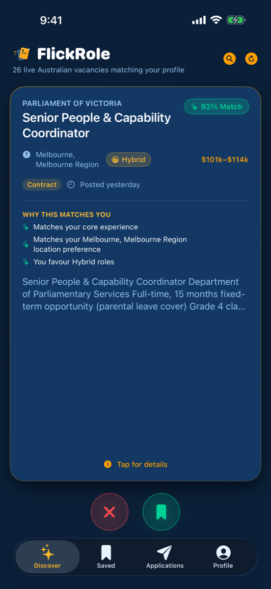
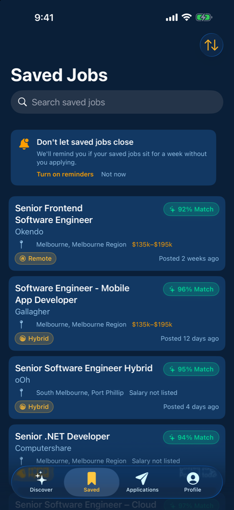
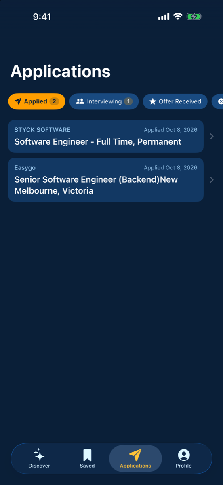
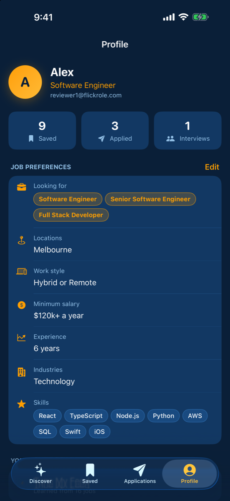

# FlickRole website

The public website for **FlickRole**, a swipe-based job-discovery app for Australia. It hosts the app's privacy policy and support pages and is served with GitHub Pages:

**https://tallaprs15.github.io/flickrole-site/** · [Privacy policy](https://tallaprs15.github.io/flickrole-site/privacy/) · [Support](https://tallaprs15.github.io/flickrole-site/support/)

<p align="center">
  
  
  
  
</p>
<p align="center"><sub>Discover · Saved · Applications · Profile</sub></p>

## About the app

Swipe right on jobs you like and left on the ones you don't, and the feed learns from every swipe. Each job shows a match score and why it fits. Save jobs, apply on the employer's site in one tap, and track every application from Applied to Offer. You can import a resume or LinkedIn PDF to set up your profile in seconds.

| | |
|---|---|
| **iOS** | SwiftUI · iOS 17+ · submitted to the App Store |
| **Android** | Jetpack Compose · Android 8+ |
| **Backend** | Supabase (Auth, Postgres with row-level security, edge functions) |
| **Personalisation** | On-device Bayesian learning-to-rank over the user's swipes, saves and applies |
| **Jobs** | Australia-wide listings from the Adzuna API, synced daily |

The app's source code is private. I'm happy to walk through it on request.

## This repo

```
index.html          Landing page
privacy/index.html  Privacy policy (kept in sync with the apps and the App Store privacy answers)
support/index.html  Support and contact
style.css, icon.png
```

Built by [Srikant Tallapragada](https://github.com/tallaprs15).
